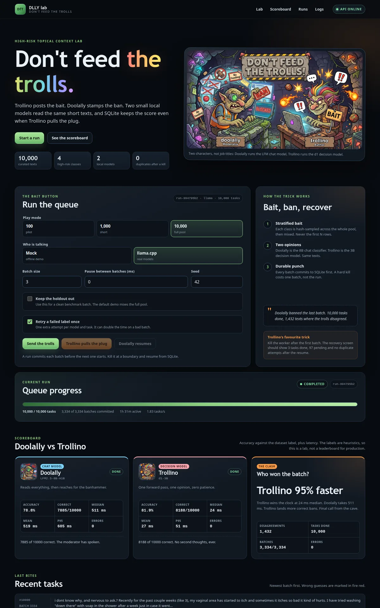

# Don't feed the trolls

A durable high-risk text classification lab with two small local models, a live GUI, and a crash-recovery demo.

**Live site:** https://doolally.trollino.rodeo

**Source:** https://github.com/AISidesKicks/doolally-trollino-rodeo



Trollino posts the bait. Doolally stamps the ban. Both trolls read the same short texts, and SQLite keeps the score even when Trollino pulls the plug.

The troll names and titles are a story device, not model job titles. Doolally runs on the LFM chat model. Trollino runs on the d1 decision model.

This is an educational project about the real cost of AI infrastructure: accuracy, latency, memory and recovery. It is not a production moderation system.

## What it shows

- How far small local models get on a narrow four-class task.
- How much faster a 3B decision model is than an 8B chat model.
- How a durable worker recovers after a hard SIGKILL with no duplicate work.
- How one retry changes the cost and the result.
- Which parts of the stack need a GPU and which do not.

## Measured results

Three real runs on the same RTX 4070, retry 1, zero provider errors.

| Sample | Model | Accuracy | Median latency | Disagreements | Active time |
| --- | --- | --- | --- | --- | --- |
| 100 clean | LFM2.5-8B-A1B | 81.0% | 593 ms | 13 | 1.0 min |
| 100 clean | d1-3B | 85.0% | 27 ms | 13 | 1.0 min |
| 1,000 clean | LFM2.5-8B-A1B | 77.8% | 606 ms | 152 | 10.3 min |
| 1,000 clean | d1-3B | 81.8% | 27 ms | 152 | 10.3 min |
| 10,000 full | LFM2.5-8B-A1B | 78.9% | 511 ms | 1,432 | 91.2 min |
| 10,000 full | d1-3B | 81.9% | 24 ms | 1,432 | 91.2 min |

- The 100 and 1,000 runs exclude the holdout. The 10,000 run is the full pool and includes it by design.
- 34 batches for 100, 334 for 1,000, 3,334 for 10,000.
- 200, 2,000 and 20,000 attempts. Zero errors and zero retries at every size.
- d1 was 4.0 points more accurate at 100 and 1,000, and 3.0 points more accurate at 10,000.
- d1 answered about 22x faster at every size. That is about 95% less latency.

Per-class F1:

| Class | 100 LFM | 100 d1 | 1,000 LFM | 1,000 d1 | 10,000 LFM | 10,000 d1 |
| --- | --- | --- | --- | --- | --- | --- |
| Politics & Elections | 81.5% | 86.2% | 72.3% | 78.2% | 74.2% | 79.2% |
| Medical & Health | 92.3% | 94.1% | 93.0% | 92.7% | 93.3% | 92.8% |
| Legal & Regulatory | 73.1% | 75.6% | 65.1% | 69.2% | 66.2% | 69.7% |
| Financial & Crypto | 76.2% | 82.6% | 81.1% | 85.9% | 82.0% | 84.6% |

Legal is the hard class at every size. LFM over-predicts Legal on the larger samples: at 10,000 it predicted Legal 2,829 times for 2,500 expected rows and pulled 559 Politics rows into it. d1 predicted Legal 2,266 times and split Legal and Politics more evenly.

The 100-task numbers are the pilot. The 1,000 and 10,000 runs are the stronger evidence, and they agree: the 3B decision model matches or beats the 8B chat model on this narrow task at a fraction of the latency and disk.

The optional LFM2.5-8B-A1B FT was tested on the 100-task pilot at 65% and 110 ms. It was faster but less accurate, so it is not the default.

Full notes, per-class confusion and the parser mistakes behind the first bad run: [mds/benchmarks.md](mds/benchmarks.md).

## Architecture

```
browser GUI (built into gui/)
        |
        v
Node 24 worker  --  durable runner  --  SQLite (runs, tasks, attempts, batches)
        |
        +--> llama.cpp server (LFM2.5-8B-A1B)
        +--> llama.cpp server (d1-3B)
        +--> optional llama.cpp server (LFM2.5-8B-A1B FT)
        |
        +--> Arize Phoenix (one span per committed batch)

Python flow (pixi dlly)  --  dataset sampling and preparation
```

- **Node 24** is required for built-in `node:sqlite`.
- **Durable runner** commits a batch before the next one starts and resumes from the first uncommitted batch.
- **GUI** is plain HTML, CSS and JS. Build output goes to `gui/`; source is in `src/gui/`.
- **Docker** runs the models, Phoenix and the lab. All resources use the `dlly-` prefix.
- **Python** in pixi prepares the dataset. It does not run the live demo.

## Quick start

Prerequisites: Node 24, pixi, Docker with the NVIDIA container runtime, and about 8 GB of free disk for the default models.

```bash
# 1. dataset is committed, models are not
pixi run python lab/models/download.py

# 2. build and start the stack
docker compose -f docker/compose.yaml up -d --build

# 3. open the dashboard
open http://127.0.0.1:3030
```

Phoenix is at http://127.0.0.1:6006. The worker sends one span per committed batch.

The mock provider runs without Docker, models or a GPU:

```bash
npm run build:gui
npm run server
# use provider "Mock" in the dashboard
```

More Docker detail: [docker/README.md](docker/README.md).

## Play modes

| Mode | Tasks | Sampling |
| --- | --- | --- |
| `100` | 100 | 25 rows per class, stratified hash sample |
| `1000` | 1,000 | 250 rows per class |
| `10000` | 10,000 | the whole pool, shuffled |

The canonical file is globally shuffled with a SHA-256 order key. Play batches are never the first N rows. The sampler orders each class by a stable hash and mixes the classes again. See [lab/datasets/sample.py](lab/datasets/sample.py).

Add `--exclude-holdout` for a clean benchmark batch. By default the demo includes the full pool.

### Run the 1,000 mode

In the dashboard:

1. Choose play mode **1,000**.
2. Choose provider **llama.cpp**.
3. Set batch size **3**, pause **0** for a benchmark, or **1000-2500** for a watchable demo.
4. Tick **Keep the holdout out** for a clean benchmark.
5. Keep **Retry a failed label once** on.
6. Press **Send the trolls**.

Or start it through the API and poll the run:

```bash
curl -sS -X POST http://127.0.0.1:3030/api/runs \
  -H 'content-type: application/json' \
  -d '{"mode":1000,"provider":"llama","batchSize":3,"pauseMs":0,"retries":1,"excludeHoldout":true}'

# use the returned run id
curl -sS http://127.0.0.1:3030/api/runs/run-xxxxxxxx
```

The 1,000 mode takes 250 rows per class from the non-holdout folds when `excludeHoldout` is true. It produces 1,000 tasks and 334 batches at batch size 3.

### Run the 10,000 mode

The 10,000 mode uses the whole pool, including the holdout. The clean non-holdout pool has only 2,000 rows per class, so a clean 10,000 sample is not possible by definition. It produces 10,000 tasks and 3,334 batches at batch size 3.

In the dashboard:

1. Choose play mode **10,000**.
2. Choose provider **llama.cpp**.
3. Set batch size **3** and pause **0**. Expect a long run, about 91 minutes on the RTX 4070 with stock LFM.
4. Leave **Keep the holdout out** unticked.
5. Keep **Retry a failed label once** on.
6. Press **Send the trolls**.

Through the API:

```bash
curl -sS -X POST http://127.0.0.1:3030/api/runs \
  -H 'content-type: application/json' \
  -d '{"mode":10000,"provider":"llama","batchSize":3,"pauseMs":0,"retries":1,"excludeHoldout":false}'
```

The 10,000 run is a stress run, not a quick demo. Use the 100 and 1,000 modes for iteration and the full pool for the final claim.

## Recovery proof

- Kill after batch 2: 6 tasks committed, 94 pending.
- Resume from SQLite.
- Final state: 100 tasks, 34 committed batches, exactly 200 attempts for two models.
- Zero duplicate `(run_id, task_position, model)` rows.
- The GUI shows the durable batch, the pending count and a real resume button.

The batch commit is the unit of durability. If a batch is interrupted before it is marked done, the worker reuses the attempts that were already committed.

## Models

| Key | Model | Size | Role |
| --- | --- | --- | --- |
| `lfm` | LFM2.5-8B-A1B Q4_K_M | 5.16 GB | chat classifier, reasoning capped at 128 tokens |
| `d1` | d1-3B Q4_K_M | 1.67 GB | decision model, `/v1/systemone` |
| `lfm-ft` | LFM2.5-8B-A1B FT Q4KXL | 6.17 GB | optional instruction-tuned variant |

Weights live in `models/gguf/` and are gitignored. Sizes, hashes and licenses: [models/README.md](models/README.md).

The optional fine-tune is called **LFM2.5-8B-A1B FT** in this repo. Its upstream repo name includes the training framework, which is also an agent harness name, so the app does not use it.

## Dataset

- 10,000 rows, 2,500 per class.
- 8 experiment folds of 1,000 rows plus a 2,000-row holdout.
- Text capped at 2,000 characters, about 500 tokens.
- Sources: 8,230 Yahoo Answers rows and 1,770 AG News rows.
- Labels are heuristics, not gold annotations.

The canonical JSONL, manifest and source metadata are committed in [datasets/](datasets/). Provenance, licenses and caveats: [datasets/README.md](datasets/README.md) and [datasets/SOURCES.json](datasets/SOURCES.json).

## Deep dives

- [mds/benchmarks.md](mds/benchmarks.md) - measured results, parser fixes and the optional fine-tune.
- [lfm/insidellm.md](lfm/insidellm.md) - policy and content-risk classification notes from the lab LFM model.
- [mds/datasets.md](mds/datasets.md) - source datasets, labels and license notes.
- [mds/durable-execution.md](mds/durable-execution.md) - Pi Durable, crash recovery and replay references.
- [INTENT.md](INTENT.md) - project intent, play modes, architecture and status.
- [lab/datasets/README.md](lab/datasets/README.md) - builder, folds, sampling and verification.

## Repository layout

| Path | What it is |
| --- | --- |
| `src/` | Node worker, server, providers, tracing and GUI source |
| `src/gui/` | plain HTML, CSS and JS dashboard |
| `gui/` | GUI build output, gitignored |
| `docs/` | static GitHub Pages site for https://doolally.trollino.rodeo |
| `lab/` | dataset builder, sampler and model downloader |
| `mds/` | deep dives and reference lists |
| `lfm/` | LFM-specific notes and prompt experiments |
| `datasets/` | committed 10k pool, manifest and provenance |
| `models/` | local GGUF weights, tracked README and placeholders |
| `docker/` | compose stack and Node image |
| `tests/` | Python dataset tests and Node worker tests |
| `scratch/` | local logs, screenshots and artefacts, gitignored |

## Tests

```bash
pixi run python -m unittest discover -s tests
npm test
```

Current coverage:

- Python: dataset shape, folds, sampling balance, source provenance.
- Node: Python parity for mode 100, 1,000 and 10,000 selection, mock runs, one retry, kill and resume with no duplicate attempts, API smoke test, OTLP span export.

## Commands

```bash
# worker, direct
npm run worker -- run --mode 100 --provider mock
npm run worker -- run --mode 100 --provider llama --models lfm,d1 --retries 1

# a clean 1,000-task benchmark on the host
npm run worker -- run --mode 1000 --provider llama --models lfm,d1 --retries 1 --exclude-holdout

# a clean 1,000-task benchmark in the running Docker stack
curl -sS -X POST http://127.0.0.1:3030/api/runs \
  -H 'content-type: application/json' \
  -d '{"mode":1000,"provider":"llama","batchSize":3,"pauseMs":0,"retries":1,"excludeHoldout":true}'

# status and history
npm run worker -- list
npm run worker -- status --run-id run-xxxxxxxx

# GUI
npm run build:gui
npm run server

# dataset batch
pixi run python lab/datasets/sample.py --mode 1000 --exclude-holdout
```

## Secrets

`.env` is local only and gitignored. `HF_TOKEN` is read-only and is never written to datasets, logs or manifests. See [.env.example](.env.example).

## License

MIT. See [LICENSE](LICENSE).
